# BioSense BLE — nodo de monitoreo para biodigestores de ultra bajo consumo

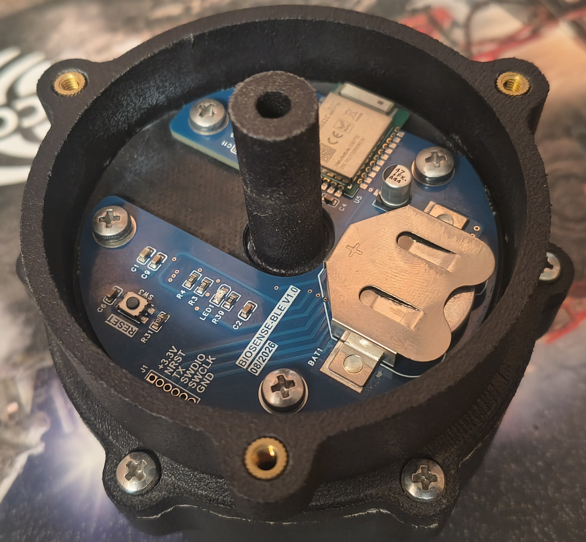

Sistema inalámbrico de temperatura, humedad, presión relativa y voltaje de
batería. Está formado por un sensor basado en nRF52840 y una aplicación Flutter
que recibe los datos directamente desde la publicidad BLE.

## EasyEDA Spark 2026

**BioSense BLE participa en [EasyEDA Spark 2026](https://oshwlab.com/recommend/easyeda-spark-2026) y está patrocinado por [EasyEDA](https://easyeda.com/).** El hardware abierto y la documentación del proyecto se publican en [OSHWLab](https://oshwlab.com/marse/project_xujrbbrw).

<p align="center">
  <a href="https://oshwlab.com/recommend/easyeda-spark-2026">
    
  </a>
</p>

<table align="center">
  <tr>
    <td align="center" width="50%">
      <a href="https://easyeda.com/">
        
      </a>
      <br>
      <strong>Patrocinado por EasyEDA</strong>
    </td>
    <td align="center" width="50%">
      <a href="https://oshwlab.com/marse/project_xujrbbrw">
        
      </a>
      <br>
      <strong>Publicado en OSHWLab</strong>
    </td>
  </tr>
</table>

## Proyectos

| Carpeta | Descripción |
| --- | --- |
| [BioSense_BLE_code_nrf52840/](BioSense_BLE_code_nrf52840/README.md) | Firmware Zephyr/nRF Connect SDK para el Ebyte E73-2G4M08S1C |
| [app_biosense/](app_biosense/README.md) | Aplicación Flutter para Android |
| [doc/](doc/) | Imágenes, documentación y análisis de consumo con el PPK2 |

Cada proyecto contiene su propio README con instrucciones de compilación y uso.

## Arquitectura

```text
HTU21D (0x40) ----\
                   \
WF100DPZ (0x6D) ----> E73-2G4M08S1C / nRF52840
VDD por SAADC ------/      |
                           | Manufacturer Data BLE, -20 dBm
                           | ráfaga de 2 s cada 60 s
                           v
                    Aplicación Flutter
```

No se establece una conexión BLE. El teléfono solamente escanea los anuncios,
lo que simplifica el protocolo y permite apagar la radio entre mediciones.

## Esquemático electrónico

El esquemático reúne la alimentación mediante CR2032, el módulo
E73-2G4M08S1C con nRF52840, el cristal externo de 32.768 kHz, la interfaz SWD,
el LED de diagnóstico y el bus I2C compartido por los sensores HTU21D y
WF100DPZ.

<p align="center">
  <a href="doc/SCH_Schematic1_2026-10-25.pdf">
    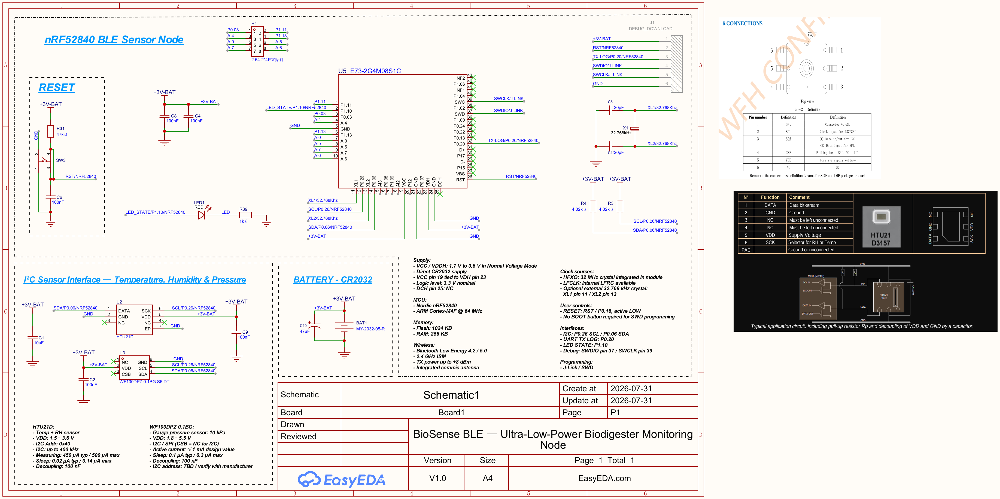
  </a>
</p>

La imagen abre el documento original en PDF. También puede descargarse desde
[`doc/SCH_Schematic1_2026-10-25.pdf`](doc/SCH_Schematic1_2026-10-25.pdf).

## Hardware principal

<table>
  <tr>
    <td align="center" width="50%">
      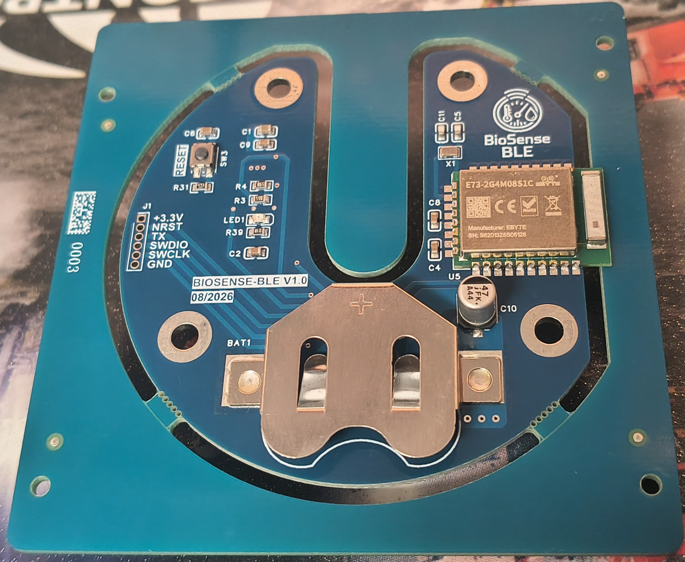
      <br>
      <strong>PCB BioSense BLE — vista superior</strong>
    </td>
    <td align="center" width="50%">
      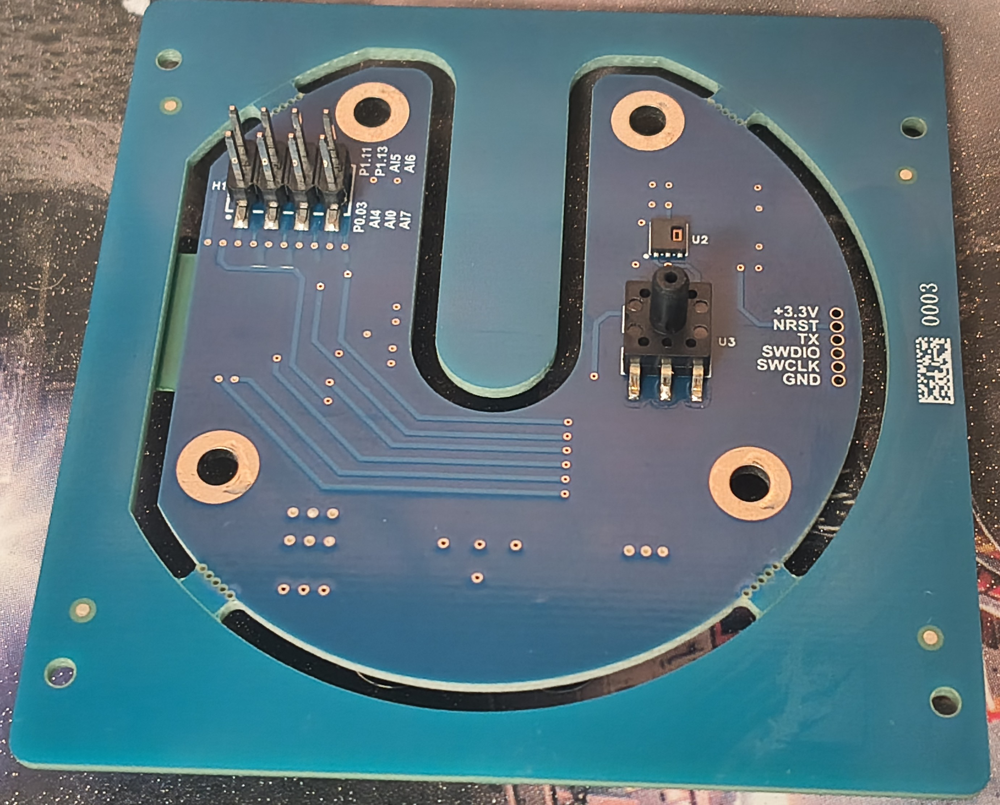
      <br>
      <strong>PCB BioSense BLE — vista inferior</strong>
    </td>
  </tr>
</table>

- Módulo Ebyte E73-2G4M08S1C con nRF52840.
- HTU21D para temperatura y humedad, dirección I2C `0x40`.
- WF100DPZ para presión relativa, dirección I2C `0x6D`.
- Bus I2C: SCL P0.26 y SDA P0.06 a 100 kHz.
- LED activo en alto conectado a P1.10.
- UART TX de diagnóstico en P0.20 a 115200 baudios.
- Cristal LF externo de 32.768 kHz entre XL1 y XL2.
- Alimentación prevista mediante CR2032.

La placa circular reúne el módulo BLE, el portapila, el pulsador de reinicio,
los pads SWD y los sensores. La carcasa protege la electrónica y ofrece una
conexión neumática central para medir presión relativa.

<p align="center">
  
</p>

> BioSense BLE es un prototipo experimental y no sustituye un instrumento
> certificado de presión o seguridad de gases. El sellado, la condensación y
> la compatibilidad de los materiales deben validarse en la instalación final.

## Estrategia de bajo consumo

- Potencia BLE configurada en **-20 dBm** para alcance corto.
- Ráfaga publicitaria de 2 segundos cada 60 segundos.
- Publicidad no conectable; no mantiene enlaces activos.
- LFCLK proveniente del cristal externo de 32.768 kHz.
- CPU inactiva entre ciclos mediante el kernel de Zephyr.
- Consola, UART, banner y logs deshabilitados en producción.
- LED apagado durante la operación normal.

El alcance real no depende únicamente de la potencia: también influyen la
antena del módulo, la PCB, la carcasa, el cuerpo humano, el ruido de 2.4 GHz y
el teléfono. Debe validarse el objetivo de 1 a 2 metros con el producto
ensamblado.

## Aplicación BioSense

La aplicación Flutter filtra exclusivamente las tramas BioSense y muestra
temperatura, humedad, presión relativa, voltaje, RSSI, identificador BLE y hora
de recepción. Las copias repetidas de una misma ráfaga se descartan; las
tarjetas y el indicador de recepción se animan únicamente cuando llega un
número de secuencia nuevo.

<p align="center">
  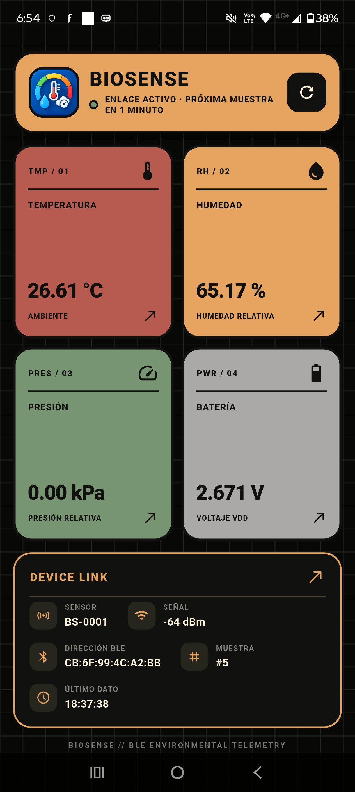
</p>

## Datos transmitidos

La trama BLE v1 contiene:

- Device ID y número de secuencia.
- Temperatura en centésimas de grado Celsius.
- Humedad en centésimas de porcentaje.
- Presión relativa en centésimas de kPa.
- VDD en milivoltios.
- Indicador de batería baja por debajo de 2.4 V.

Durante desarrollo se usa el Company ID `0xFFFF`. Antes de comercializar el
producto debe sustituirse por un Company Identifier asignado o por otro formato
de publicidad que no reserve indebidamente ese identificador.

## Medición de consumo con Nordic PPK2

Las pruebas se realizaron con un **Nordic Power Profiler Kit II** en modo
amperímetro, Power Profiler v4.4.1 y 100 000 muestras por segundo. El firmware
utilizó la configuración de producción y una potencia BLE de -20 dBm.

<table>
  <tr>
    <td align="center" width="50%">
      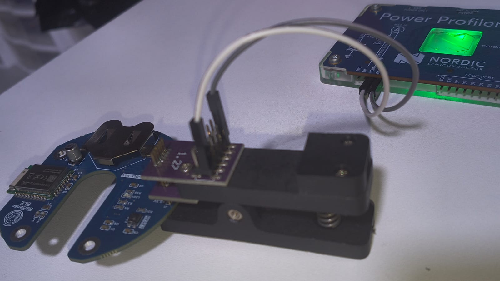
      <br>
      <strong>Conexión de medición</strong>
    </td>
    <td align="center" width="50%">
      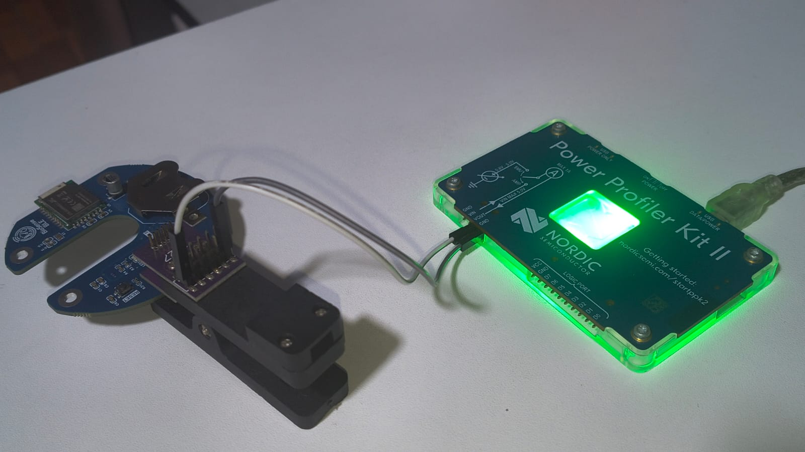
      <br>
      <strong>Banco de pruebas con el PPK2</strong>
    </td>
  </tr>
</table>

### Resultados principales

| Ventana medida | Duración | Corriente media | Corriente máxima | Carga |
|---|---:|---:|---:|---:|
| Arranque | 10.00 s | 3.00 µA | 52.85 mA | 30.00 µC |
| Microevento BLE | 2.110 ms | 4.92 mA | 15.35 mA | 10.38 µC |
| Ráfaga BLE completa | 2.127 s | 177.34 µA | 16.34 mA | 377.25 µC |
| Ciclo completo | 60 s | **8.62 µA** | 16.34 mA | 517.07 µC |
| Dos ciclos | 120 s | **8.63 µA** | 16.34 mA | ~1.04 mC |

<p align="center">
  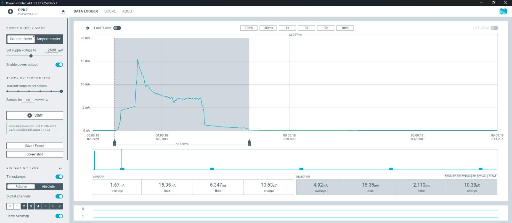
  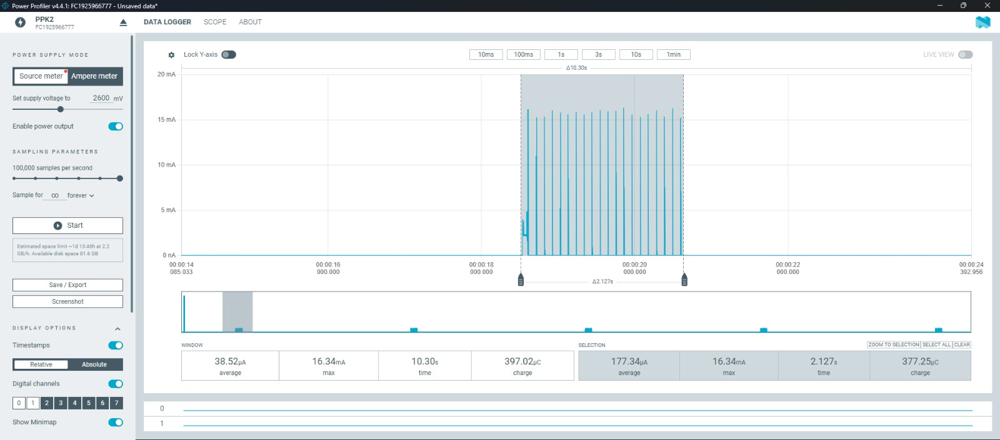
</p>

La primera captura detalla un microevento de radio de 2.110 ms. La segunda
abarca la ráfaga publicitaria completa de 2.127 s, que consume 377.25 µC.

<p align="center">
  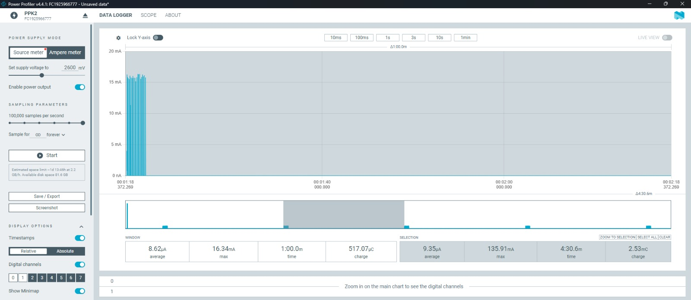
  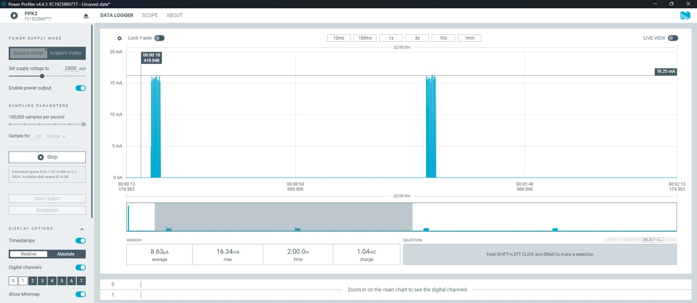
</p>

El ciclo de 60 segundos promedia 8.62 µA y acumula 517.07 µC. La captura de
120 segundos registra dos ráfagas y conserva prácticamente el mismo promedio,
8.63 µA, lo que confirma la repetición prevista una vez por minuto.

<p align="center">
  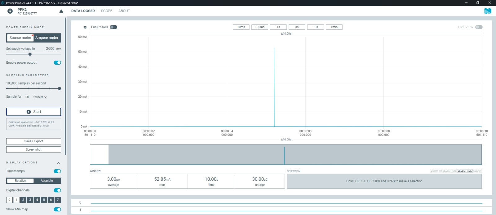
</p>

La ráfaga BLE representa aproximadamente el **73 % de la carga consumida por
minuto**: 377.25 µC de un total de 517.07 µC. Por diferencia, la adquisición y
el reposo aportan unos 139.82 µC durante el resto del ciclo. Esta última cifra
es una inferencia entre ventanas medidas, no una medición aislada del reposo.

El informe completo está disponible en
[`doc/BioSense_BLE_Informe_Consumo_PPK2.pdf`](doc/BioSense_BLE_Informe_Consumo_PPK2.pdf).

### Estimación ideal con CR2032

| Capacidad nominal | Autonomía ideal calculada con 8.62 µA |
|---:|---:|
| 200 mAh | 2.65 años |
| 220 mAh | 2.91 años |
| 240 mAh | 3.18 años |

Estas cifras son referencias de ingeniería, no una autonomía garantizada. La
vida real será menor por la autodescarga, la temperatura, la resistencia
interna, la capacidad de entregar pulsos, las fugas de la PCB, la tensión de
corte y la variación entre pilas. También debe investigarse un máximo aislado
de 135.91 mA observado en una captura extendida, pues no corresponde a los
picos BLE identificados.

## Inicio rápido

Firmware:

```powershell
cd BioSense_BLE_code_nrf52840
west build -p always -b supermini_custom/nrf52840 .
west flash -d build -r pyocd
```

Aplicación:

```powershell
cd app_biosense
flutter pub get
flutter run
```

Al encender el sensor debe estar sin presión aplicada para que el WF100DPZ haga
su tara. Mantenga la aplicación abierta; una medición nueva puede tardar hasta
60 segundos.
